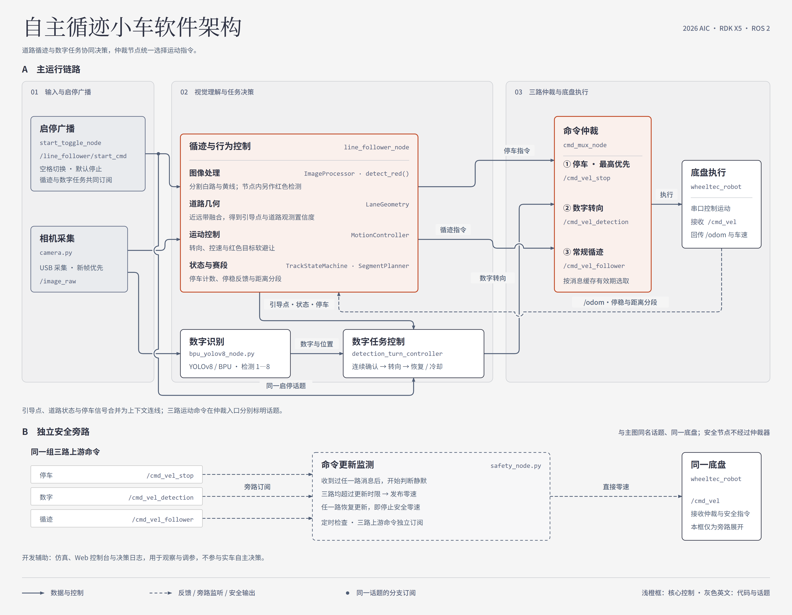

# 2026 AIC 智能车视觉规划赛

**自主循迹与视觉决策系统技术文档**

**运行平台：** RDK X5 / Wheeltec 阿克曼转向底盘 / ROS 2 TROS Humble  
**文档日期：** 2026 年 11 月 1 日

---

## 摘要

本项目面向岔路与环岛两类复赛地图，以道路循迹、黄色标线停车和赛段推进为行驶主线，并在此基础上实现红色目标局部避让与数字目标转向两个附加功能。道路与标线通过 HSV 颜色分割结合几何分析处理，数字识别由 YOLOv8 网络在 RDK X5 的 BPU 上完成。C++ 控制程序根据图像观测、里程计反馈和任务状态实时计算线速度与角速度，经优先级仲裁后下发至底盘。

感知层面，系统在图像 ROI 中设置近远双采样带，分别捕捉车头附近的横向位置和前方道路走向，并结合道路宽度与观测可靠度动态调节转向和速度。决策层面，黄线事件与累计路程共同驱动赛段切换，数字识别则经多帧候选确认后触发短时转向动作。两类赛道共用同一套控制程序，差异通过各赛段的独立参数配置体现。

---

## 一、任务特点与方案选择

复赛地图包含直道、分岔、连续反向弯和环岛，白色可行驶区域的宽度与轮廓随路段持续变化。这对循迹程序提出了两个并行要求：一是准确判断车头当前的横向偏差，二是提前感知前方道路的弯曲趋势，二者缺一不可。在分岔和环岛位置，还需根据当前赛段策略调整速度与转向强度。

在感知手段的选择上，道路白区、黄色标线和红色目标均具有稳定的颜色与几何特征，适合以 HSV 分割、形态学处理和区域分析处理；数字目标因笔画细节与背景差异较大，采用轻量神经网络完成检测，并通过连续帧观测加以确认，避免单帧误检触发不必要的转向动作。

在执行架构上，道路控制在图像回调中逐帧运行，保持较低的控制延迟；数字推理则由独立线程调用板载 BPU 执行，与道路控制互不阻塞。里程计用于停稳判断和赛段距离累计，视觉负责实时估计道路位置与偏差。

---

## 二、软件结构与执行顺序

### 2.1 节点协作

*图1　主要运行节点及消息关系。上部展示视觉处理、任务决策与底盘执行的主干流程，下部展示安全节点对三路运动命令的独立订阅关系。*

相机通过 `/image_raw` 同时向循迹节点和数字检测节点提供图像。`line_follower_node` 负责道路提取、停车状态管理和循迹命令生成；`bpu_yolov8_node.py` 向外发布数字类别、置信度与检测框坐标；`detection_turn_controller` 汇合道路引导点和当前运行状态，生成数字转向命令。

`start_toggle_node` 发布 `line_follower/start_cmd`，循迹与数字任务共同订阅该话题以接收启停信号。`cmd_mux_node` 收集停车、数字转向和常规循迹三路命令，按优先级选择后统一向底盘发布 `/cmd_vel`。底盘回传的 `/odom` 进入循迹节点，用于更新停车状态、累计行驶路程，并由 `SegmentPlanner` 确定当前赛段。

代码按职责划分目录：`src/camera/` 实现相机采集，`src/yolov8/` 实现数字推理，`src/line_follow_ws/src/line_follower/` 包含循迹、数字任务、仲裁和启停四个可执行程序，`src/car_ws/` 承载底盘驱动。两类赛道的参数配置分别保存在 `tools/config/fork.yaml` 和 `tools/config/roundabout.yaml`。

基础依赖方面，ROS 2 承担节点间通信，OpenCV 提供图像处理算子，YOLOv8 与 BPU 运行库支撑数字检测，底盘通信复用 Wheeltec 驱动与串口访问库。应用层在此之上构建道路观测、赛段控制、行为状态机和命令仲裁四个核心环节。

### 2.2 循迹节点内部结构

`LineFollowerNode` 负责消息收发、执行调度和结果发布，内部算法由六个 C++ 模块分工承担：

| 模块 | 职责说明 |
|---|---|
| `ImageProcessor` | 截取 ROI、提取道路掩膜、检测黄色标线区域 |
| `LaneGeometry` | 计算近远带道路区间、引导点坐标、横向误差、方向指标和观测置信度 |
| `TrackStateMachine` | 管理黄线锁存、停车计时、停稳反馈、丢线状态与最终停车逻辑 |
| `SegmentPlanner` | 依据黄线计数与累计路程推进赛段，向主节点返回当前段号 |
| `MotionController` | 计算循迹速度与转向、丢线恢复动作，并融合红色目标的避让修正量 |
| `DebugRenderer` | 将道路掩膜、引导点和目标位置叠加渲染至调试图像 |

模块之间以结构体传递中间结果：`SegmentedFrame` 携带图像分割与标线检测结果，`LaneObservation` 携带道路几何参数与可靠度评分，`MotionCommand` 携带线速度、角速度和停车发布标记。红色目标的轮廓检测与方向投票由主节点统一组织，最终的运动修正量交由 `MotionController` 计算并叠加。

### 2.3 每帧执行顺序

每帧图像进入回调后，处理分三步推进：首先完成道路分割与几何观测，同时将归一化引导点发布给数字任务节点；随后根据黄线状态更新赛段，选择循迹控制或丢线保持策略；最后将循迹指令叠加视觉前馈、赛段转向偏置和红色目标避让修正，统一施加停车约束后发布。黄线触发停车期间，主节点同步发出循迹零速与高优先级停车命令，两路并行以确保底盘响应。

### 2.4 参数加载与运行记录

`tools/start.sh` 在启动时根据赛道类型选取对应地图配置。各节点先读取该配置文件，再加载 `line_follower_with_detection.launch.py` 中的话题与仲裁设置；同名参数以后加载的为准。赛段切换时，主节点从已加载的参数集合中提取当前段的控制设置，无需重新读取文件。

日志字段单位约定如下：线速度以 `m/s` 计，角速度与转向偏置以 `rad/s` 计，路程以 `m` 计，时长以 `s` 计。引导点坐标按图像宽高归一化，横向误差按图像半宽归一化，面积判据以像素占比表示。启动脚本同时保存所选配置文件的副本，主节点记录读取的参数值，便于事后将运行日志与地图配置对应核查。

---

## 三、道路感知与循迹控制

### 3.1 图像采集与道路分割

`camera.py` 通过 V4L2 接口采集 USB 相机图像，按配置文件设定图像格式、分辨率和目标帧率，以 `bgr8` 编码发布至 ROS 2 话题。采集缓冲与发布队列均采用小容量设计，确保控制程序始终优先取到最新画面。图像消息携带采集时间戳，后续数字检测结果沿用同一消息头，以保持时间对齐。

`ImageProcessor` 依据配置的上下边界比例从原图中截取 ROI，将处理范围集中在车头前方的道路区域，既排除了远处天空与背景的干扰，也避开了车头近端因透视形变导致的无效区域。

道路分割流程：先对 ROI 做高斯平滑以压制噪点，再利用白色区域低饱和度、较高亮度的像素特性，按饱和度上限和亮度下限进行阈值筛选，得到初始二值掩膜；随后依次执行形态学开运算去除孤立噪点、闭运算填补局部空洞。程序还对掩膜提取外轮廓，保留最大有效轮廓的包围盒与质心，当近远采样带均无法形成引导点时，以该质心作为兜底的补充观测。

### 3.2 近远双带与引导点

分岔口或宽路面处，白色可行驶区域横向延展，单一位置的采样难以同时表达"车头在哪"和"前方往哪走"两个信息。为此，系统在 ROI 内设置纵向间隔的近带和远带：近带反映车头附近的横向位置，远带反映前方道路的延伸趋势，二者共同构成横向引导依据。

采样时，每个带逐列统计白色像素数量，将像素占比超过阈值的连续列划定为道路区间，并剔除过窄的噪声区间。近带以图像中心为参考选取最近的有效区间；远带在近带有效时优先向近带中心对齐，覆盖参考位置的候选优先采用，其余候选按与参考的距离排序，距离相同时取较宽者。这一约束使远带的选择跟随近带位置，在分岔处自然排除另一支路的干扰。

设图像宽度为 $W$，近带中心横坐标为 $x_n$，远带中心横坐标为 $x_f$，两带的归一化偏差分别为：

$$
e_n=\frac{x_n-W/2}{W/2},\qquad
e_f=\frac{x_f-W/2}{W/2}.
$$

两带均有效时，以权重 $w_n,w_f$（$w_n+w_f=1$）加权得到目标横向位置，再归一化为横向误差：

$$
x_t=w_nx_n+w_fx_f,\qquad
e=\operatorname{clip}\!\left(\frac{x_t-W/2}{W/2},\,-1,\,1\right).
$$

$e>0$ 表示引导点偏向画面右侧。权重分配决定近端位置与前方趋势各自的权重：近带权重偏高时，控制器更关注当前偏差的纠正；远带权重偏高时，弯道方向的变化能够更早介入转向。

在此基础上，系统以近远带偏差之差描述道路弯曲方向，定义原始方向指标：

$$
\psi_{\mathrm{raw}}=\operatorname{clip}(e_f-e_n,\,-1,\,1).
$$

当两带均有效、远带两侧触及画面边界但近带仍保有边界信息时，宽路处理改以近带偏差作为方向参考；仅远带有效时使用远带偏差；仅近带有效时则对历史方向指标施加衰减。综合上述分支与滤波历史，程序最终得到平滑后的方向指标 $\psi$。

### 3.3 宽道路可靠度与观测平滑

当道路区间宽度过大或一侧边界超出画面时，可见白区的几何中点往往偏离实际行驶位置，单纯依赖中心坐标会引入系统性偏差。`LaneGeometry` 为每个采样带单独记录区间宽度、边界是否被裁剪和对应的可靠度权值。

环岛配置中启用宽度自适应融合：将近远带的基础权重分别乘以各带可靠度后重新归一化，可靠度低的采样带自动降低影响；仅一侧边界可见时，结合名义道路宽度反推中心位置，作为对截断偏差的补偿。

道路观测整体评分综合考虑宽度可靠性、近远带一致程度、帧间位置稳定性和轮廓有效性，加权后得出单帧置信度。该评分同时参与速度与转向控制：置信度低于阈值时限制线速度；若当前帧的转向输出较弱，则按比例保留历史转向，避免宽白区中心偏移时车辆突然回正。环岛赛段还对横向误差与方向指标额外施加一阶低通滤波，滤波系数决定当前帧与历史帧的混合比例，在弯道跟踪速度与观测抖动抑制之间取得平衡。

### 3.4 连续反向弯处理

连续反向弯路段中，近带和远带的偏差可能分别落在画面中心两侧：近带指示当前弯向，远带已指向下一弯向。若直接融合两带，正负偏差相互抵消，会产生接近零的转向输出，使车辆在弯道中直行冲出边界。

系统通过以下条件检测反向弯：两带误差符号相反、各自幅值超过最小偏差阈值，且差值超过判定门限；上述条件持续满足指定帧数后激活反向弯模式，持续满足退出条件后解除。进入该模式后，控制器专注于可靠度更高的近带偏差，引导车辆先完成当前弯向的修正，再随近带逐步过渡到下一弯向，同时关闭方向附加项并施加速度上限以留出转向余量。激活与解除均设置独立的帧数确认，防止短暂的观测波动引发模式误切换。

### 3.5 转向、前馈与控速

`MotionController` 根据横向误差 $e$ 和方向指标 $\psi$ 计算基础循迹角速度：

$$
\omega_p=\operatorname{clip}\!\left[-(K_pe+K_h^{\mathrm{eff}}\psi),\;-\omega_{\max},\;\omega_{\max}\right].
$$

$K_p$ 决定横向偏差的纠偏力度，$K_h^{\mathrm{eff}}$ 决定前方弯道方向变化的响应强度；反向弯模式下 $K_h^{\mathrm{eff}}$ 归零，仅保留近带偏差的比例项。负号约定与图像坐标系一致：引导点偏右时车辆右转。观测置信度正常时直接使用上述结果；置信度偏低时按前节策略与历史转向混合，避免单帧异常观测引起剧烈摆动。

主节点在 $\omega_p$ 基础上叠加视觉前馈和赛段转向偏置：

$$
f_t=\alpha_{\mathrm{ff}}(e_f-e_n)+(1-\alpha_{\mathrm{ff}})f_{t-1},\qquad
\omega=\operatorname{clip}\!\left(\omega_{\mathrm{lane}}-K_{\mathrm{ff}}\eta_v f_t+B(s),\;-\omega_{\max},\;\omega_{\max}\right).
$$

$f_t$ 是对近远带差值的一阶平滑，代表前方弯道变化趋势的估计；$\omega_{\mathrm{lane}}$ 为 `MotionController` 输出的角速度，$B(s)$ 为当前赛段的转向偏置，$\alpha_{\mathrm{ff}}$ 和 $K_{\mathrm{ff}}$ 分别控制平滑程度和前馈增益。启用速度缩放时，$\eta_v$ 随里程计实测车速在设定范围内线性变化，使前馈幅度随车速自适应调整。前馈补充了近远带差值反映的方向需求，其参与程度在各赛段独立配置。

速度控制将横向偏差、道路弯曲程度和目标速度三者结合。弯曲程度代理量 $c_{\mathrm{img}}$（对应代码中的 `curvature_proxy`）在两带均有效时取近远带位置差的绝对值，仅单带有效时取方向指标幅值；启用宽路处理时再加入宽度超出比例的加权项，最终取较大值并截断至归一化区间。令综合误差和弯曲代理量分别为：

$$
E=|e|+k_{\psi}\bigl|K_h^{\mathrm{eff}}\psi\bigr|,\qquad
q=\max\!\left(|e_f-e_n|,\;c_{\mathrm{img}}\right),
$$

则当前帧速度为：

$$
v=\operatorname{clip}\!\left\{v_t\!\left[1-\lambda\min\!\left(1,\,a_e E+a_q q\right)\right],\;v_{\min},\;v_{\max}\right\}.
$$

$v_t$ 为当前赛段目标速度，$\lambda$ 为弯道降速上限系数；$k_{\psi}$、$a_e$、$a_q$ 分别调节方向偏差、综合误差和弯曲程度对降速比例的贡献。偏差和弯曲程度越大，车辆主动降速越多，为后续转向修正留出时间裕量。急弯、连续反向弯和低置信度观测各自设有独立速度上限，作为上述连续降速策略之外的硬性约束。

---

## 四、赛段规划与地图策略

### 4.1 黄线事件与距离分段

直道、弯道和分岔对控制参数的需求差异较大，同一套固定参数无法兼顾各路段的速度与精度要求。`SegmentPlanner` 依据复赛地图的黄线分布和路段结构划分赛段，以黄线出现次数和距上一次黄线的累计路程作为进段依据。规划器返回当前段号，主节点据此切换对应的控制参数组；道路位置的逐帧修正仍由视觉实时完成，两者分工明确。

里程计每次更新时，以纵向速度绝对值对时间积分累计路程：

$$
s_k=s_{k-1}+\left|v_{\mathrm{odom},k}\right|\Delta t.
$$

每确认一次新的黄线事件，距黄线的累计路程清零重算；切换赛段时，段内累计路程同步重置。赛段编号在一轮运行中单调递增，后续黄线触发的路程清零不会回退已进入的赛段。

### 4.2 两类赛道的控制侧重

| 赛道 | 核心任务 | 控制策略 |
|---|---|---|
| 岔路 | 选支与恢复循迹 | 以黄线事件和累计路程界定选支窗口，在该窗口内叠加近端道路反馈与转向偏置；选支完成后撤销偏置，恢复纯道路观测循迹 |
| 环岛 | 连续转弯与出口过渡 | 依靠远带观测与宽路可靠度引导弯道跟踪，结合视觉前馈提前响应弯道变化，各赛段分别设定目标速度、横向增益与降速强度 |

各赛段除速度、横向增益和弯道降速外，还单独配置前馈参数和转向偏置。进入控制律后，这些参数与逐帧道路偏差联合作用，决定最终输出。赛段边界以黄线次数或累计路程表示，参数在地图配置文件中集中管理，便于针对具体赛道调整而不影响算法逻辑。

### 4.3 赛段内转向偏置

转向偏置 $B(s)$ 与视觉纠偏叠加作用于同一角速度输出。选支阶段沿目标支路方向施加偏置，同时道路位置反馈仍然有效，确保选支过程中车辆不脱离可行驶区域；选支完成后偏置归零，控制权回到纯道路观测，车辆自然恢复路中行驶。偏置的方向、幅度和生效路程范围在配置文件中独立描述，分别对应选支意图、修正力度和持续区间。

`steer_bias_at()` 函数以段内累计路程为输入计算当前偏置值，支持两种配置形式：在整个选支赛段持续施加固定偏置，或按路程依次设置偏置段、无偏置间隔和后续偏置段，以应对需要二次选支的复杂路口。

赛段切换时，节点同步更新目标速度、横向增益、转向上限、弯道控制和前馈参数，并清除观测滤波器与前馈的历史状态，确保新赛段从干净的初始状态起步。各赛段底层共用同一套循迹算法，参数差异覆盖了赛道策略的全部变化。

---

## 五、黄色标线停车与运行状态

### 5.1 黄色标线检测与计数

黄色标线在独立的 HSV 掩膜中检测，按预设的色相范围、饱和度下限和亮度下限筛选像素，再计算黄色像素面积占 ROI 的比例，与阈值比较后得出该帧的标线检测结论。

首次检出时，`TrackStateMachine` 锁存当前标线事件并将计数加一；在同一标线持续可见期间，状态机沿用同一事件，不重复计数。停车释放与黄线去重逻辑相互独立：停车按自身的释放条件结束，计数锁存则等到连续未检出帧数超过清除阈值后解除。这样即便停车已提前释放，后续短暂重检出同一标线也不会产生额外计数。

黄线计数在三处共用：停车次数管理、赛段推进条件判断和最终停车触发。标线触发停车时，还会同步通知数字任务撤销当前正在执行的转向动作。

### 5.2 停车与停稳反馈

黄线触发停车后，主节点将线速度与角速度置零，同时向 `/cmd_vel_stop` 发布高优先级停车命令，并经 `/cmd_vel_follower` 补发循迹零速。两路命令并行确保仲裁器在任何路径下均能收到停车信号。停车期间，节点持续读取里程计纵向速度，用于判断车辆是否真正停稳。

里程计回调维护一个低速标记：速度持续低于阈值时记录进入时刻；速度超出范围时立即清除该标记。状态机以低速标记和经过时间计算停稳保持时长，并按以下双分支条件决定释放时机：

$$
\mathrm{release}=
\bigl(t_y\geq t_{\min}\ \wedge\ t_{\mathrm{still}}\geq\tau\bigr)
\ \vee\ \bigl(t_y\geq T_{\mathrm{stop}}\bigr).
$$

$t_y$ 为本次黄线事件后的经过时间，$t_{\mathrm{still}}$ 为低速持续时间；$t_{\min}$ 为最短停车时间，$\tau$ 为要求的低速保持时长，$T_{\mathrm{stop}}$ 为超时强制释放时长。前一分支在车辆实际停稳后尽快恢复行驶；后一分支作为兜底，防止因里程计异常导致车辆长期驻停。两者任一满足即结束本次临时停车。

黄线计数未到最终停车次数时执行临时停车；达到配置次数后进入最终停车，此后持续保持零速直至手动重启。重新启动会清空黄线计数、赛段进度和相关动作状态；中途暂停则保留已完成的赛段，重新启动后从断点继续。

### 5.3 丢线时的动作衔接

路面颜色异常或相机视野受遮挡时，道路掩膜可能在短时间内消失。丢线期间，控制器保留最近一帧记录的运动方向，并按衰减系数逐帧减弱转向幅度，避免车辆在惯性下过度转向。随着丢线时长增加，程序依次切换三个处置阶段：短时维持原方向继续前进、降低线速度等待道路重现、线速度归零原地等待。状态机以丢线时长阈值标记 `LOST` 状态，一旦道路重新可见即恢复正常循迹。三段式处置使偶发的短暂中断与真正的持续丢线得到有差别的响应。

---

## 六、红色目标检测与软避让

### 6.1 颜色、形状与方向判断

红色在 HSV 色相空间中跨越 0° 附近的首尾两段，单一色相范围无法完整覆盖。程序分别提取低色相段和高色相段，结合饱和度下限与亮度下限过滤得到各自的红色掩膜，合并后再执行形态学处理填补内部空洞，最后对轮廓进行几何筛选。

筛选时，程序先以包围盒宽高比和宽度占画面比例识别横向条状目标（如地面标记带）；其余候选按最小宽度、高度和轮廓面积占比逐一过滤。最终优先取非条状候选中面积最大的目标，其次处理横向条状目标，使路锥与条状标记分别进入对应的避让分支，避免将两者混用同一策略。

方向判断上，对于一般目标，程序以车前参考点到道路引导点的连线为行驶基准，判断目标落在连线左侧还是右侧，并向相反方向施加修正；对于横向条状目标，则比较目标左右两侧的可见空间，选择较宽的一侧通行。方向结论需在连续多帧中保持一致并达到投票计数阈值后才正式生效，防止单帧噪声引发错误避让。

### 6.2 接近程度与循迹融合

目标包围盒的底边在图像中近似对应目标接地点的投影位置。系统将底边相对 ROI 上沿的纵向位置归一化为高度比例 $b$，并据此计算当前帧的接近程度：

$$
r=\operatorname{clip}\!\left(\frac{b-b_{\mathrm{near}}}{b_{\mathrm{close}}-b_{\mathrm{near}}},\;0,\;1\right).
$$

$b_{\mathrm{near}}$ 为开始避让的近距离阈值，$b_{\mathrm{close}}$ 为进入近距离处理的阈值。方向确认后，程序同时计算目标底边到当前行驶引导线的横向距离：底边位置达到 $b_{\mathrm{near}}$ 且目标落在预计行驶区域内时启动软避让；达到 $b_{\mathrm{close}}$ 时直接进入近距离避让，不再等待距离判断。

软避让在循迹角速度上叠加一个背离目标方向的修正量，修正幅度随 $r$ 从零线性增大。不同目标类型对应不同的基础修正系数，再按 $r$ 放大为实际叠加量。若此时循迹方向本身朝向目标一侧，系统先适度削弱该方向的循迹分量，再叠加避让修正，避免两者相加产生过大转向。连续反向弯中，为防止避让修正与当前弯向冲突，额外限制修正量上限。速度随目标类型和 $r$ 同步降低，但不归零，以保持前进动作完成绕行。整套避让修正以增量形式叠加在常规循迹命令中，仲裁层无需感知。

---

## 七、数字识别与转向任务

### 7.1 板载 YOLOv8 推理

`bpu_yolov8_node.py` 在启动时加载 `src/yolov8/mod1/best_modified_yolov8.bin`，并读取同目录 `out.list` 建立模型输出索引与数字类别 1—8 的映射关系。输入图像先按比例缩放、四边补黑边至模型要求的输入分辨率，以保留数字的长宽比，再转换为 NV12 格式送入 BPU 执行前向推理。

后处理在 CPU 端完成：分类置信度经 Sigmoid 激活，检测框四条边各自通过离散分布求期望偏移量，再结合特征图网格坐标和对应步长还原到原始图像坐标系。最后按缩放比例和补边偏移将所有检测框映射回原图，依据置信度阈值和框间重叠率执行筛选与非极大值抑制（NMS）。检测结果通过 `ai_msgs/msg/PerceptionTargets` 消息发布，包含类别标签、置信度和框坐标。

### 7.2 最新图像优先的异步处理

数字推理的耗时高于图像采集周期，若按队列顺序处理，积压的旧帧会导致检测结果持续滞后于当前画面。`LatestFrameSlot` 采用覆盖式缓冲：槽位中始终只保存一张待推理图像，新图像到达时直接覆盖尚未被取走的旧图像，确保推理线程每次取到的都是最近一帧。

检测结果在调试图绘制完成之前单独发布，调试图另设独立的限频策略，两者解耦。控制程序因此能以较高频率接收新的检测结果，而不受可视化渲染节奏的影响。

### 7.3 多帧候选确认

单帧检测存在误检和位置抖动，直接触发转向容易导致误动作。`DetectionTurnLogic` 引入多帧候选确认机制：检测框中心坐标和道路引导点坐标均以全图尺寸归一化（横坐标除以图像宽度，纵坐标除以图像高度）。消息到达时，节点取最近有效引导点，检查其时效性和候选的连续性；候选还须同时满足置信度下限、位置连续性要求和纵向对齐条件，稳定通过上述门限达到规定帧数后，才进入动作确认阶段。

对通过门限的候选，程序按类别分别维护平均置信度、最高置信度、有效出现次数、位置一致性评分和平滑横向偏差，并以综合评分排序选优：

$$
S=\beta_c C+\beta_n N+\beta_p P.
$$

三个评分项的计算规则如下：

- $C$ 将平均置信度与最高置信度加权求和，兼顾观测持续性和单帧清晰度。
- $N$ 取有效出现次数与最小确认次数之比，并设置上界防止长时观测对评分的无限累积。
- $P$ 以相邻帧归一化坐标的欧氏距离计算位置一致性，距离越小得分越高，再对历次得分做指数平滑。

权重 $\beta_c,\beta_n,\beta_p$ 决定三项的相对重要性。程序先用出现次数、平均置信度和位置一致性作硬门限筛选，再在通过者中取综合评分最高的候选，动作方向由该候选框中心相对当前道路引导点的横向偏移决定。

### 7.4 短时转向与视觉恢复

数字转向任务按顺序经历六个阶段：等待、候选积累、动作确认、执行、视觉恢复和冷却。确认阶段以数字框中心相对道路引导点的平滑横向偏差 $\Delta x$ 计算转向角速度：

$$
\omega_d=\operatorname{clip}(s_d K_d \Delta x,\;-\omega_{d,\max},\;\omega_{d,\max}).
$$

$s_d$ 修正图像坐标方向与车辆转向方向的符号约定，$K_d$ 为增益，$\omega_{d,\max}$ 为上限。执行阶段锁定确认时的 $\omega_d$ 值，以配置的动作线速度前进，并按控制周期递进计时。达到最短动作时间后，若道路状态为 `tracking`、引导点时效内且连续满足居中确认条件，则提前结束动作；超出最长动作时间时也强制退出，防止卡死在执行阶段。

动作结束后，节点停止发布数字转向请求；仲裁器在数字命令缓存到期后自动将控制权切回常规循迹，无需显式通知。数字任务随即进入冷却阶段，在此期间忽略同一目标的重复检测。已完成的数字转向通过可见记录和消失时间条件去重，黄线事件或重新启动时清空相关记录。启停关闭、黄线停车或收到停车命令时，数字控制器立即撤销当前动作。

---

## 八、命令仲裁与底盘执行

### 8.1 三类任务的控制权

`cmd_mux_node` 管理三路运动命令的选用优先级：

| 优先级 | 命令话题 | 发布方 | 含义 |
|---|---|---|---|
| 1（最高） | `/cmd_vel_stop` | `line_follower_node` | 停车请求，覆盖一切运动命令 |
| 2 | `/cmd_vel_detection` | `detection_turn_controller` | 数字任务接管期间的转向命令 |
| 3 | `/cmd_vel_follower` | `line_follower_node` | 常规循迹与红色目标避让的基础命令 |

仲裁器每次收到新命令时，检查停车缓存和数字缓存的内容及有效期，按上表优先级选择输出。停车缓存和数字缓存各自设有独立的有效时长；高优先级方停止发布、缓存到期后，下一帧输入自动将控制权交回低优先级方。常规循迹命令中已内嵌红色目标的避让修正，数字任务持有控制权期间，仲裁器只转发数字转向命令，循迹修正暂时挂起；停车请求无论何时到来始终优先。

数字任务控制器同时订阅停车话题，收到停车信号后立即撤销当前转向动作，确保停车命令能绕过仲裁器直接中断数字任务。

### 8.2 底盘通信与反馈

`turn_on_wheeltec_robot` 包中的 `wheeltec_robot` 节点订阅 `/cmd_vel`，按串口协议的比例系数将线速度和角速度各自编码为有符号整数，加入帧头、帧尾和异或校验后通过串口发送至下位机。下位机收到报文后驱动电机和转向机构执行对应的运动。

接收方向，节点持续读取底盘回传帧，校验通过后解析速度、姿态和电压数据，并以纵向速度积分更新里程计。循迹节点从 `/odom` 话题读取纵向速度，用于停稳判断和赛段路程累计。

### 8.3 命令更新监测

`safety_node.py` 独立订阅三路上游命令话题，不经过仲裁器。首次收到任意一路消息后开始计时监测；若三路话题同时超过更新时限，节点视为上游控制程序整体异常，转而持续向 `/cmd_vel` 发布零速命令；任一路恢复正常发布后，安全节点立即停止零速输出，将话题控制权还给仲裁器。安全节点与仲裁器都连接同一底盘速度话题，两者在正常运行时互不干扰，仅在上游整体失联时由安全节点接管。

---

## 九、开发与调试支持

仿真工具以赛道俯视图作为相机背景，结合带一阶速度和转向响应特性的自行车模型，向正式循迹程序合成提供图像流和里程计数据，并以 `/sim/cmd_vel` 接收速度指令。控制程序的 C++ 代码在仿真与实车间直接复用，不需修改；开发阶段可在仿真中反复观察道路跟踪效果、停车事件时序和赛段切换逻辑，对比调参前后的车辆轨迹变化，显著缩短实车调试周期。

Web 控制台实时显示循迹图像、数字检测图像、节点在线状态、当前赛段信息和决策日志，并提供地图参数的在线保存和相关进程的一键重启功能。启停状态统一由 `start_toggle_node` 管理，控制台操作和物理按键均向该节点发送指令。

`tools/start.sh` 统一组织各进程的启动顺序并保存运行日志；`dec_collector.py` 持续监听带 `[DEC]` 标记的日志行，将黄线停车、红色目标避让、数字转向动作和控制源切换等关键决策事件提取并汇总为结构化记录，便于赛后复盘。仿真与可视化工具专用于开发调试，实车比赛时仅运行车端感知与控制节点。
